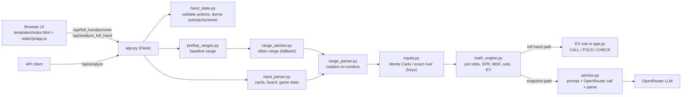

# PokerBot

[](https://github.com/dhurvapatil/poker_bot/actions/workflows/tests.yml)

A heads-up Texas Hold'em advisor that computes poker math deterministically (pot odds, SPR, MDF, outs, EV, Monte Carlo equity) and exposes it through a Flask web UI and an optional LLM decision layer.

<!-- TODO(dhruva): add demo.gif recorded from the web UI -->

## Why it's interesting

LLMs are unreliable at arithmetic and probability. PokerBot does not ask a model to estimate odds. A deterministic engine computes every number first, and any LLM call receives those figures in the prompt (`advisor.build_prompt`) and is asked to reason over them and pick FOLD, CALL or RAISE. The math is unit-tested and reproducible; only the final judgement call is left to a model.

## Features

- **Pot odds, SPR, MDF, EV of calling**: closed-form calculations in `math_engine.py`.
- **Outs estimation**: flush draws, straight draws (open-ended and gutshot), overcards, and made-hand improvements (pair to trips, two pair to full house, set to full house or quads). This is a heuristic estimate, capped at 21.
- **Monte Carlo equity via [treys](https://github.com/ihendley/treys)** against a villain range. Accuracy is controlled by the `num_simulations` argument (default 10,000) and an optional RNG `seed` for reproducibility. The snapshot endpoint runs 10,000 simulations; the full-hand endpoint runs 2,000 with a fixed seed. On the river the villain range is enumerated exactly, so no sampling error. Dead cards (hero and board) are removed from the range before simulating.
- **Range parser** for standard notation such as `TT+, AKs, ATo+, 88-55`.
- **Full-hand builder UI**: set up a heads-up hand, add actions street by street, and the backend validates legality, derives pot, stacks and street transitions, and tells the UI whether analysis is allowed.

## Architecture



There are two analysis paths:

- **Full-hand path** (`/api/analyze_full_hand`, used by the web UI): no LLM call. The villain range comes from a fixed baseline and the decision is a rule on computed EV.
- **Snapshot path** (`/api/analyze`, JSON API): hole cards, board, pot, stacks and a villain range go in; metrics are computed and sent to the LLM for a decision. The current web UI does not call this endpoint.

## How the snapshot decision pipeline works

1. Parse and validate input (cards, board size 0/3/4/5, no duplicate or overlapping cards, positive stacks). The street is derived from the board size.
2. Expand the villain range string into concrete card combos, removing combos that collide with hero or board cards.
3. Compute hero equity with 10,000 Monte Carlo simulations (exact enumeration on the river).
4. Compute pot odds, SPR, MDF, outs and EV of calling from that equity.
5. Build a structured prompt containing the hand and every computed metric.
6. Call OpenRouter (`temperature` 0.3, `max_tokens` 1024, 30 s timeout) and parse the `DECISION`, `RAISE_SIZE` and `CONFIDENCE` fields from the reply.
7. If the call fails or the reply cannot be parsed, return an `ERROR` decision with the reason. The computed metrics are still returned.

## Quickstart

```bash
git clone https://github.com/dhurvapatil/poker_bot.git
cd poker_bot
python -m venv .venv
source .venv/bin/activate        # Windows: .venv\Scripts\activate
pip install -r requirements.txt

cp .env.example .env             # then set OPENROUTER_API_KEY
python -m pokerbot.app           # http://localhost:5000
```

| Variable | Required | Description |
|---|---|---|
| `OPENROUTER_API_KEY` | Only for the LLM snapshot endpoint | Key from https://openrouter.ai/keys |
| `OPENROUTER_MODEL` | No | Any OpenRouter model id. Default: `z-ai/glm-4.5-air:free` |

The full-hand web UI works without an API key.

## Testing

```bash
python -m pytest tests -v -m "not integration"
```

The suite has 145 tests. 141 are offline and pass (this is what CI runs, on Python 3.12). The other 4 are marked `integration`; they call the real LLM and need `OPENROUTER_API_KEY` and network access, so they fail without a key. Run them with `python -m pytest tests/test_integration.py -v`.

## Project structure

```text
pokerbot/
  app.py             Flask app and API routes
  advisor.py         Prompt building, OpenRouter call, response parsing
  equity.py          Monte Carlo equity and exact river enumeration (treys)
  math_engine.py     Pot odds, SPR, MDF, outs, EV
  hand_state.py      Full-hand timeline validation and state derivation
  range_parser.py    Range notation to card combos
  range_advisor.py   Villain range estimate (currently a fallback)
  preflop_ranges.py  Baseline preflop range
  input_parser.py    Card, board and game-state parsing
  constants.py       Ranks, suits, positions, streets
  templates/ static/ Single-page web UI
tests/               pytest suite
docs/                PRD, plan, issue breakdown, vertical slices
```

## Design decisions and limitations

- **Heads-up only.** The hand builder and state machine model two players, with stacks in big blinds. No multiway pots or tournaments.
- **The web UI does not use the LLM yet.** The full-hand path decides by a simple rule: call if EV of calling is non-negative, otherwise fold (or check when no bet is faced). It never recommends a raise.
- **Villain range is a fixed baseline.** `range_advisor.py` currently returns a generic heads-up continuing range with LOW confidence. The villain profile (Nit, Maniac, etc.) is validated but does not yet change the range. LLM-based range estimation is planned in `docs/`, not implemented.
- **LLM output is non-deterministic.** Metrics are reproducible; the model's advice is not, even at low temperature. The default model is a free-tier one, which is rate-limited and weaker than paid models. Set `OPENROUTER_MODEL` to change it.
- **Outs are a heuristic.** Overlap between draws is approximated, and outs do not account for opponent range.
- **Equity is only as good as the range.** Single-point equity against a rough range is not a solver result, and this is not a GTO tool.
- **Not validated against real hand histories.** Correctness evidence is the unit test suite.

## Roadmap

- Wire the LLM into the full-hand path and make the villain profile shape the range.
- Add raise sizing and EV for raising, not only calling.
- Add a deterministic mock LLM client so the decision layer can be tested in CI.
- Record a demo and add multiway support.

## License

MIT. See [LICENSE](LICENSE).
